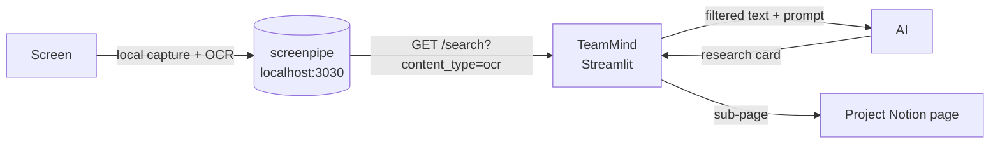

# TeamMind

**Collaborative research with one button: each member's session becomes a shared, sourced research card.**

Built at the *Build Agents That Remember* hackathon (École 42 Paris, October 16 to 18, 2026), Track 3: *Make it work for a team*.

<!-- TODO: replace with the Loom link -->
[Watch the 2-minute demo](https://www.loom.com/share/REPLACE_ME)

## What it does

**The problem.** Whenever a group researches a topic together (students preparing a presentation, a team launching a product, friends planning a trip), each member reads dozens of pages on their own share of the work. Nobody takes clean notes, nobody shares them, and the AI that helped them forgets everything.

**The solution.** TeamMind is a two-button app. **Start my day** launches screenpipe. **Wrap up & publish** reads what was on screen, drops the noise, has an AI write a sourced research card, and publishes it as a sub-page of the project's Notion knowledge base. Every member's session ends up in the same place, whatever the subject.

Demo example: **SkyCab**, a fictional flying-taxi startup, with three members researching the market, the regulation and the technology.

## How screenpipe is used



- **Recording.** *Start my day* launches screenpipe if it is not running (desktop app, AppImage or CLI; the CLI runs at 0.2 fps with audio disabled). *Wrap up* stops it, so recording only covers the work session.
- **Retrieval.** TeamMind calls `GET /search?content_type=ocr` on the local API, keeps captures from work apps only (browsers, Notion, Obsidian, VS Code, Cursor, PDF readers, terminal), drops short fragments and duplicates.
- **AI.** TeamMind reuses the AI already configured in screenpipe (presets in its settings), then falls back to `ANTHROPIC_API_KEY` or the `claude` CLI. With no AI available, it outputs a ready-to-paste prompt instead.
- **Author.** The card is signed with the first name of the screenpipe account.
- **Local first.** Raw history stays on the machine; only the generated card is sent to Notion.

### Per-project prompt, stored in Notion

Each project's Notion page doubles as configuration. Its text is passed to the AI as project context, and a heading containing **"prompt"** and **"end of session"** (or **"wrap-up"**) introduces a custom prompt, with `{author}`, `{project}` and `{corpus}` placeholders. Without one, a default card template is used.

## How to run it

**Prerequisites:** macOS or Linux, Python 3.10+, screenpipe installed (desktop app, AppImage next to the script, or `screenpipe` CLI in `PATH`), a Notion integration with the project page shared with it.

```bash
git clone https://github.com/SystemicYogi/teamMind-hackathon-42-Entrepreneurs-screenpipe.git
cd teamMind-hackathon-42-Entrepreneurs-screenpipe
pip install streamlit requests pillow   # the only dependencies (no requirements.txt yet)

export NOTION_API_KEY=your-notion-integration-token
export SCREENPIPE_API_KEY=your-screenpipe-local-key   # if your screenpipe API requires one
# optional: ANTHROPIC_API_KEY, SCREENPIPE_PORT (default 3030), TEAMMIND_SKYCAB_URL

./TeamMind.sh   # or: streamlit run TeamMind.py
```

In the app: pick a project (or create one with its Notion URL), click **Start my day**, do your research, then **Wrap up & publish to Notion**. Projects are saved in `teammind_projects.json`.

For useful cards, screenpipe must capture **screen content**, not just window titles: keep screen capture on and exclude personal apps in its settings.

`TeamMind.py` is the current version; `TeamMind_0.py` to `TeamMind_6.py` are earlier iterations kept for history.

## Known limitations

- Cards are built from the 60 most recent captures, not from exact session timestamps.
- Cards are published directly; an approval step before publishing is the next thing to add.
- Summaries are only as good as the capture: with screenshots disabled, screenpipe only records window titles.

## Team

<!-- TODO: names -->
Les Expendables, École 42 Paris.
